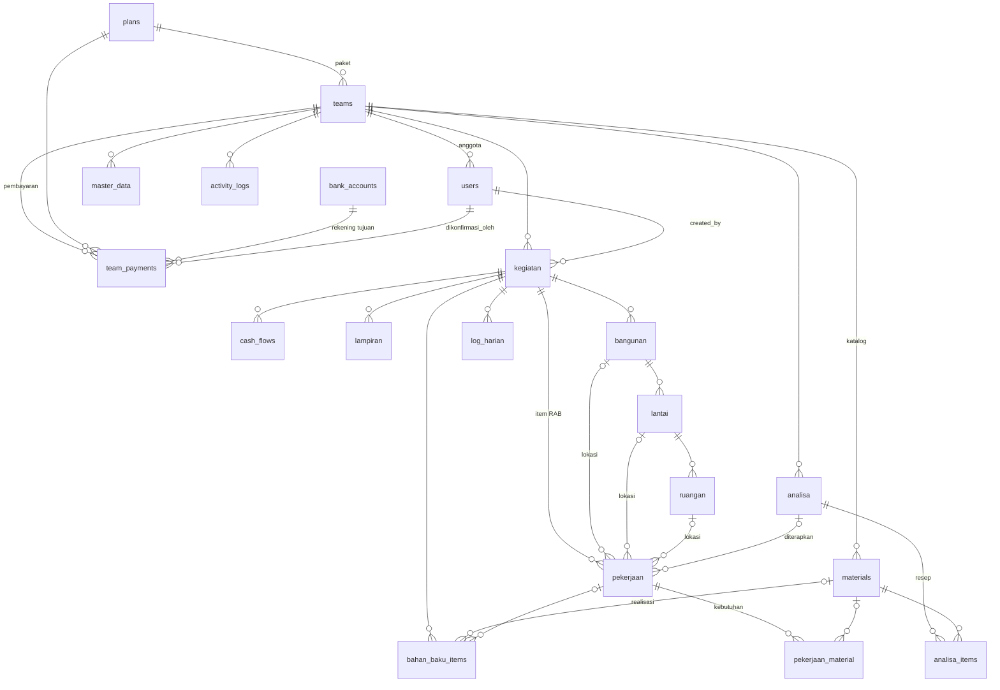

# Database Tukangsync

PostgreSQL. ID akun (`users.id`) berupa **UUID**; tabel lain memakai bigint.
Semua tabel data proyek memiliki `team_id` (FK `teams`, cascade on delete).

## Tabel

### Platform & SaaS

| Tabel | Isi |
|---|---|
| `users` | akun. `team_id` null = superadmin platform; terisi = anggota tim dengan `peran` |
| `teams` | tim/pelanggan: `slug` (kode 4 karakter, unik), `status` (menunggu/aktif/ditangguhkan), `plan_id`, `lifetime`, `aktif_sampai`, `max_users` |
| `plans` | paket: `harga`, `durasi_bulan` (null = lifetime), `max_users`, `fitur` (json) |
| `team_payments` | tagihan/pembayaran: `kode` INV-…, `jenis` (pendaftaran/perpanjangan), `nominal`, `status`, `bukti_path` (disk privat), `periode_mulai/selesai`, `dikonfirmasi_oleh` |
| `bank_accounts` | rekening tujuan transfer yang tampil di pendaftaran |
| `admin_contacts` | nomor WhatsApp admin; `utama` = tujuan tombol konfirmasi |
| `settings` | key/value identitas situs |
| `roles`, `permissions`, `model_has_*`, `role_has_permissions` | spatie/permission (panel superadmin) |
| `activity_log` | spatie activitylog (panel superadmin; `subject_id` UUID) |
| `sessions`, `password_reset_tokens`, `cache*`, `jobs`, `job_batches`, `failed_jobs`, `personal_access_tokens` | infrastruktur Laravel/Sanctum |

### Proyek (per tim)

| Tabel | Isi |
|---|---|
| `kegiatan` | proyek: kode (unik per tim), pagu, tarif & hasil taksasi, status |
| `cash_flows` | arus kas masuk/keluar per proyek |
| `bahan_baku_items` | belanja nyata; opsional `material_id`, `pekerjaan_id` |
| `lampiran` | foto struk (disk privat) |
| `master_data` | daftar acuan (satuan, toko, sumber dana) |
| `activity_logs` | jejak aktivitas API per tim |

### RAB (per tim)

| Tabel | Isi |
|---|---|
| `materials` | katalog harga material/upah/alat |
| `analisa`, `analisa_items` | AHSP: resep per 1 satuan pekerjaan (material + koefisien) |
| `bangunan` → `lantai` → `ruangan` | struktur fisik proyek |
| `pekerjaan` | item RAB: komponen, dimensi, satuan, volume, harga, total, progres |
| `pekerjaan_material` | kebutuhan per pekerjaan (salinan harga saat diterapkan) |
| `log_harian` | catatan lapangan harian |

## ERD

## Migrasi

| Berkas | Isi |
|---|---|
| `0001_01_01_*`, `2026_02_*`–`2026_09_*` | kerangka starter (users UUID, cache, jobs, permission, activity_log, settings) |
| `2026_11_08_000100_create_saas_tables.php` | plans, teams, kolom tim di users, bank_accounts, admin_contacts, team_payments |
| `2026_11_08_000200_create_proyek_tables.php` | kegiatan, cash_flows, master_data, lampiran, activity_logs, personal_access_tokens |
| `2026_11_08_000300_create_rab_tables.php` | materials, analisa, bangunan, lantai, ruangan, pekerjaan, pekerjaan_material, bahan_baku_items, log_harian |
| `2026_11_08_920000_kosongkan_default_rate_kegiatan.php` | default tarif kegiatan = 0 (sama seperti o-api) |

Hapus tim: `forceDelete()` menghapus seluruh data tim lewat cascade;
`delete()` (soft delete) hanya menyembunyikannya.
